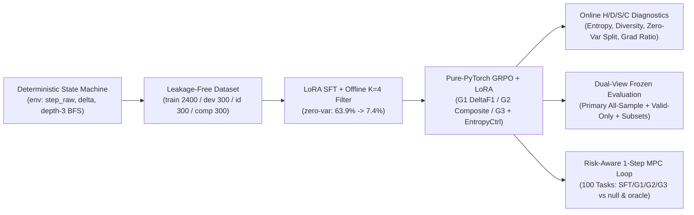
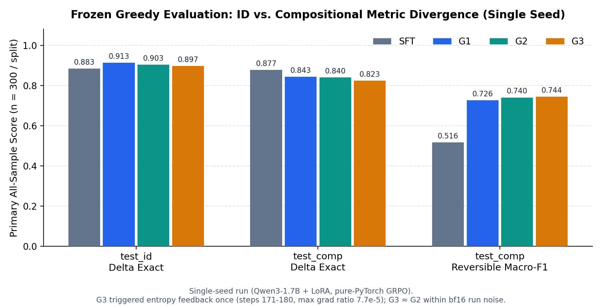
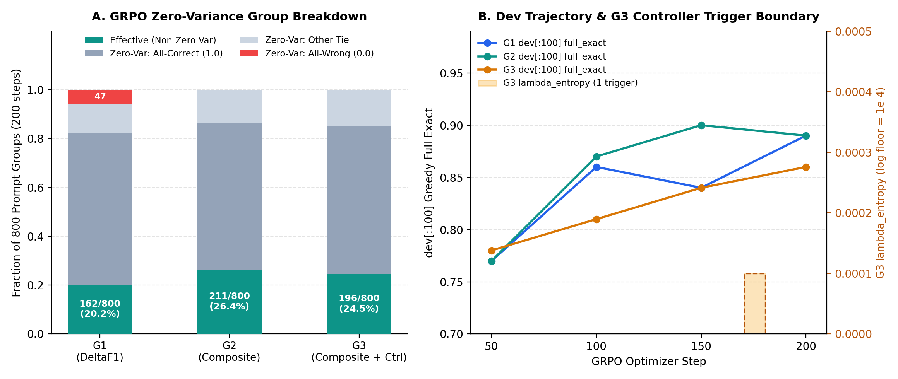
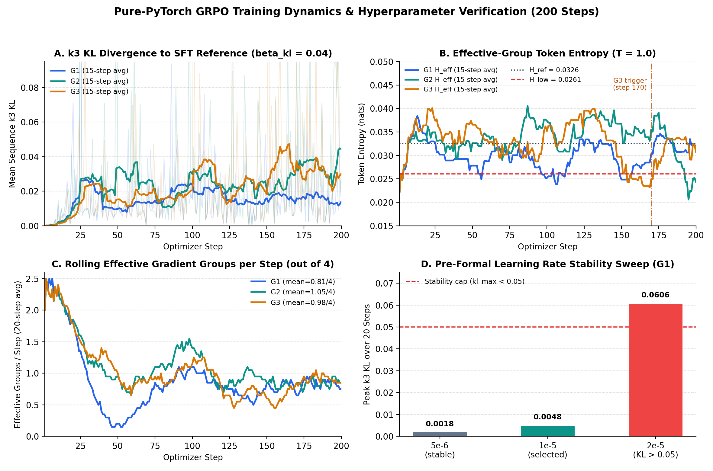
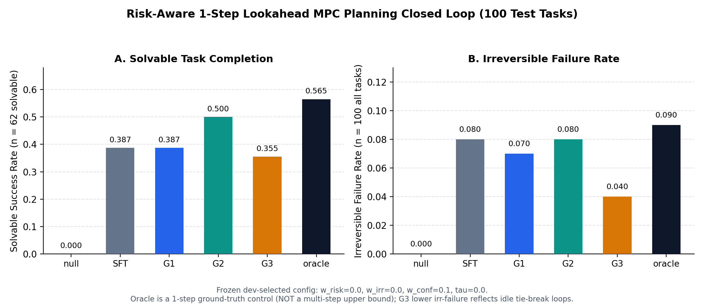

# MiniBooking-RLVR

[](https://github.com/queenyn/minibooking-rlvr/actions/workflows/ci.yml)
[](https://www.python.org/downloads/)
[](LICENSE)

**A verifiable state-delta and reversibility benchmark, pure-PyTorch GRPO implementation with online H/D/S/C post-training diagnostics, and risk-aware 1-step MPC planning loop for small LLM world models.**

`MiniBooking-RLVR` is designed as a transparent, reproducible testbed for studying how verifiable rewards shape an LLM's ability to predict **exact state deltas**, **immediate financial loss**, **bounded-depth action reversibility**, and **calibrated confidence** under both in-distribution (`test_id`) and compositional rule shifts (`test_comp`). Every component—from the integer-cent state machine and BFS reversibility oracle to the hand-written PyTorch GRPO loss, k3 KL estimator, analytical entropy gradients, and closed-loop MPC planner—is modular, dependency-light, and covered by deterministic CPU unit tests.

[中文版 README (Chinese)](README_zh.md) | [Architecture Guide](docs/architecture.md) | [Full Experiment Report](docs/experiments.md) | [Case Studies](docs/case_studies.md) | [Interactive Trajectory Viewer](demos/trajectory_viewer.html) | [Roadmap](docs/roadmap.md)

---

## System Overview



## Core Design Highlights

1. **Zero-Drift Verifiable Environment & BFS Reversibility Oracle (`minibooking_rlvr.env`)**
   - Exact integer-cent accounting and rational refund ratios (`0/1`, `1/2`, `1/1`) enforce strict money conservation (`balance_cents + paid_cents + loss_cents = const`) and non-decreasing loss across all 6 actions (`create`, `confirm`, `cancel`, `change_day`, `clear`, `inspect`).
   - Distinguishes immediate `cost` from multi-step `reversibility`: e.g., `confirm()` under half-refund rules incurs zero immediate cost (`cost = 0.0`) yet is **irreversible** (`reversible = False`) under depth-3 BFS because unwinding it incurs irreversible cancellation loss.
2. **Leakage-Free Compositional Benchmark (`minibooking_rlvr.data`)**
   - Partitions all 240 `(rules, initial_balance_cents)` scenario families across `train / dev / test_id / test_comp` **before** state sampling, guaranteeing zero cross-split scenario or canonical-input SHA256 overlap.
   - Holds out two unseen `(refund_ratio, change_fee_cents)` combinations—`(1/2, 0)` and `(1/1, 20)`—exclusively for `test_comp` while exposing every individual factor during training. Regenerating the splits reproduces all 4 frozen JSONL files **byte-for-byte**.
3. **Pure-PyTorch Hand-Written GRPO + H/D/S/C Diagnostics (`minibooking_rlvr.rl`)**
   - Written directly in PyTorch without TRL or vLLM: merges the frozen LoRA-SFT adapter into `Qwen/Qwen3-1.7B` in `bf16` and computes reference log-probabilities via `disable_adapter()` on the same weights.
   - Implements group-relative advantage normalization (`unbiased=False`), PPO-style clipped surrogate objective, Schulman's non-negative `k3` KL estimator (`exp(ref - lp) - (ref - lp) - 1`), chunked full-vocabulary token entropy (`masked_token_entropy` vs. differentiable `seq_entropy_with_grad`), and optional policy-vs-entropy gradient norm decomposition (`gn_pg`, `gn_H_reg`, `ent_grad_ratio`).
   - Tracks **H/D/S/C** diagnostics online (effective-group entropy, semantic diversity `D`, zero-variance signal breakdown `S` across `all_correct / all_wrong / mixed / parse_fail`, and mode concentration `C`) alongside an accuracy-gated `EntropyController` with strict checkpoint verification.
4. **Dual-View Frozen Evaluation & Risk-Aware 1-Step MPC Planner (`minibooking_rlvr.eval`, `minibooking_rlvr.planner`)**
   - Reports primary all-sample metrics (strictly penalizing invalid JSON/schema outputs) alongside valid-only diagnostics, confidence collapse histograms, and `allow_change=True/False` compositional slices.
   - Evaluates models inside a closed-loop 1-step lookahead MPC planner with real-state replanning against two diagnostic CPU baselines (`null` zero-delta and `oracle` ground-truth transition control).

---

## Verified Experimental Findings (Single-Seed Prototype)

All numbers below come from a single-seed (`seed=20261025`) prototype run on `Qwen/Qwen3-1.7B` + LoRA (`r=16, alpha=32`) trained with pure-PyTorch SFT (600 examples, 150 steps, completion-only loss) followed by 200-step GRPO (`K=4`, 4 prompts/step, `lr=1e-5`, `beta_kl=0.04`). All limitations and negative/null findings are reported explicitly.

### 1. Frozen Greedy Evaluation (`n = 300` per split, Primary All-Sample View)

| Model | `test_id` Exact | `test_id` Full Exact | `test_id` Rev. Macro-F1 | `test_comp` Exact | `test_comp` Full Exact | `test_comp` Rev. Macro-F1 | `test_comp` Cost MAE | `test_comp` Brier |
| :--- | :---: | :---: | :---: | :---: | :---: | :---: | :---: | :---: |
| **SFT** | 0.8833 | 0.8700 | 0.9167 | **0.8767** | 0.7267 | 0.5163 | **0.0430** | **0.1233** |
| **G1** (DeltaF1) | **0.9133** | **0.9067** | **0.9409** | 0.8433 | 0.7433 | 0.7256 | 0.0497 | 0.1567 |
| **G2** (Composite) | 0.9033 | 0.8933 | 0.9324 | 0.8400 | **0.7567** | 0.7401 | 0.0538 | 0.1600 |
| **G3** (Composite + Ctrl) | 0.8967 | 0.8833 | **0.9409** | 0.8233 | 0.7333 | **0.7435** | 0.0622 | 0.1767 |



### 2. GRPO Training Diagnostics & Controller Boundary (200 Steps, 800 Prompt Groups)

| Group | Effective Groups (Non-Zero Var) | Zero-Var Total | Zero-Var All-Correct (`1.0`) | Zero-Var All-Wrong (`0.0`) | Zero-Var Other Tie | `dev[:100]` Step 200 Full Exact |
| :--- | :---: | :---: | :---: | :---: | :---: | :---: |
| **G1** | 162 / 800 (20.3%) | 638 (79.8%) | 495 | 47 | 96 | 0.89 |
| **G2** | **211 / 800 (26.4%)** | **589 (73.6%)** | 479 | **0** | 110 | 0.89 |
| **G3** | 196 / 800 (24.5%) | 604 (75.5%) | 485 | **0** | 119 | 0.86 |





### 3. Risk-Aware 1-Step Lookahead MPC Planning Closed Loop (`n = 100` Test Tasks: 62 Solvable / 38 Unsolvable)

Frozen dev-selected planner weights: `w_risk = 0.0`, `w_irr = 0.0`, `w_conf = 0.1`, `tau = 0.0` (selected on 20 dev tasks before running test).

| Predictor | Solvable Success (`n=62`) | Unsolvable Refusal (`n=38`) | Dangerous Rate (`n=100`) | Irreversible Failure (`n=100`) | Stop Ratio | Avg. Steps |
| :--- | :---: | :---: | :---: | :---: | :---: | :---: |
| `null` (zero-delta baseline) | 0.000 (0/62) | 1.000 | 0.000 | 0.000 | 1.000 | 0.000 |
| **SFT** | 0.387 (24/62) | 0.658 | 0.040 | 0.080 | 0.390 | 2.370 |
| **G1** | 0.387 (24/62) | 0.658 | 0.040 | 0.070 | 0.380 | 2.400 |
| **G2** | **0.500 (31/62)** | 0.605 | 0.040 | 0.080 | 0.340 | 2.350 |
| **G3** | 0.355 (22/62) | 0.658 | 0.040 | 0.040\* | 0.310 | 2.780 |
| `oracle` (1-step true-delta control) | 0.565 (35/62) | 0.500 | 0.040 | 0.090 | 0.650 | 0.780 |



> **Interactive Trajectory Replay & Failure Analysis**: Open [demos/trajectory_viewer.html](demos/trajectory_viewer.html) locally in any browser (zero backend required) to step through 8 curated real closed-loop trajectories side-by-side across all 6 predictors (`SFT`, `G1`, `G2`, `G3`, `oracle`, `null`), or read the verbatim breakdown in [docs/case_studies.md](docs/case_studies.md).

### Key Diagnostic Takeaways & Strict Claim Boundaries

- **Offline K=4 difficulty filtering prevents wasted RL compute without causing regression**: Removing 1,098 all-correct prompts from the 1,800-prompt RL pool cut initial zero-variance groups from `63.9%` to `7.4%` (including removing all 254 trivial `inspect` prompts), while `inspect` exact accuracy stayed `1.0000` across `dev`, `test_id`, and `test_comp` for all four models.
- **Composite reward increases effective gradient yield over DeltaF1-only RL**: Across 800 training groups, G2/G3 raised effective non-zero-variance groups from `162` (G1) to `211` / `196` and eliminated `all_wrong` (`0.0`) ties (`47 -> 0`) because risk and Brier terms differentiate completions with identical `DeltaF1`.
- **Compositional shift exhibits metric divergence rather than uniform gain**: On `test_comp`, RL drops `0.033–0.053` on delta `exact` relative to SFT (concentrated on non-empty `cancel` omitting `balance_cents`), yet raises `reversible macro-F1` by `+0.21–0.23` (`0.5163 -> 0.7256–0.7435`, driven by `(refund=1/2, fee=0)`).
- **Confidence calibration collapsed to `1.0` at SFT initialization**: Because SFT targets used constant `confidence = 1.0`, **100%** of valid predictions across all four models output `confidence = 1.0`, reducing the Brier term to an indicator of `1 - exact`. Fixing calibration requires non-degenerate SFT calibration targets or post-hoc temperature/confidence heads (see [Roadmap](docs/roadmap.md)).
- **No efficacy claim for the entropy controller (`G3 ≈ G2`)**: In 200 steps (20 checks), `EntropyController` triggered only **once** at step 170 (`lambda = 1e-4` for steps 171–180; max entropy-to-policy gradient ratio `7.67e-5`). G2 and G3 diverged at step 5 while `lambda == 0.0` due to GPU `bf16` non-determinism (establishing `~0.06` run-to-run `dev[:100]` noise). This repo intentionally does **not** claim validation of the controller or reproduction of full DACE-RL (ARB / DUAL-EDC).
- **Why `oracle` reaches 0.565 and why G3's lower irreversible failure rate (`0.040*`) is not caution**: `oracle` shares the same 1-step lookahead horizon and candidate templates (27/27 oracle failures are threshold stops on multi-step problems). Meanwhile, 30 of G3's 40 solvable failures stem from predicting an illegal `create` on `draft` as state-changing, tying with valid actions, and idling until `max_steps=5`.

---

## Quick Start (Pure CPU, < 5 Seconds)

```bash
git clone https://github.com/queenyn/minibooking-rlvr.git
cd minibooking-rlvr
python -m pip install -e ".[dev]"

# 1. Run full unit test suite (environment, rewards, dataset, D/S/C, controller, GRPO math, eval, planner)
python -X utf8 -m pytest -v

# 2. Verify byte-identical dataset reproducibility against frozen SHA256 hashes
python -X utf8 scripts/generate_dataset.py --check

# 3. Run CPU closed-loop planning baselines (oracle & null on 100 test tasks)
python -X utf8 scripts/run_planning_eval.py --split test --predictors oracle null --no-save

# 4. Regenerate publication figures from results/summary_metrics.json
python -X utf8 scripts/plot_results.py
```

### GPU Training & Frozen Evaluation (Optional `[train]` Stack)

```bash
python -m pip install -e ".[train]"

# Step 1: LoRA SFT (completion-only loss)
python -X utf8 scripts/run_sft_train.py --data-dir data --out-dir outputs/sft

# Step 2: Pure-PyTorch GRPO (G1 / G2 / G3)
python -X utf8 scripts/run_grpo_train.py \
  --group G2 \
  --config configs/grpo_formal_config.json \
  --data-dir data \
  --sft-adapter outputs/sft/sft_adapter \
  --out-dir outputs/grpo_G2

# Step 3: Frozen greedy evaluation on test_id and test_comp
python -X utf8 scripts/run_frozen_eval.py \
  --name G2 \
  --sft-adapter outputs/sft/sft_adapter \
  --rl-adapter outputs/grpo_G2/final_adapter \
  --data-dir data \
  --out-dir outputs/eval
```

---

## Repository Structure

```text
minibooking-rlvr/
├── configs/                  # Frozen data protocol, GRPO formal config, planner config, SFT/GRPO train ID schedules
├── data/                     # Frozen byte-reproducible splits (train/dev/test_id/test_comp) + manifest
├── demos/                    # Zero-dependency interactive HTML trajectory replay viewer
├── docs/                     # Architecture guide, full experiment report, diagnostic case studies, roadmap
├── results/
│   ├── summary_metrics.json  # Single source of truth for verified experimental metrics
│   ├── training_dynamics.json# Compact 200-step GRPO logs (KL, H_eff, effective groups) + LR sweep
│   ├── sample_trajectories.json # 8 curated 6-predictor closed-loop trajectories
│   └── figures/              # Publication-style figures generated by scripts/plot_results.py
├── scripts/                  # Standalone CLI scripts for data, SFT, GRPO, frozen eval, planning, plotting, viewer
├── src/minibooking_rlvr/
│   ├── env/                  # State machine, transitions, delta extraction, depth-3 BFS reversibility
│   ├── rewards/              # Strict JSON parser (no coercion/fences) and G1/G2/G3 reward functions
│   ├── data/                 # Leakage-free scenario-family generator and frozen prompt protocol
│   ├── rl/                   # Pure-PyTorch GRPO math, H/D/S/C diagnostics, EntropyController, filtering
│   ├── eval/                 # Dual-view frozen evaluation metrics and HF batched greedy inference
│   └── planner/              # Isolated candidate proposer, 1-step MPC planner, BFS tasks, metrics
└── tests/                    # Comprehensive unit test suite (216+ deterministic CPU checks)
```

---

## Research Context & References

`MiniBooking-RLVR` is an **independent, lightweight verifiable engineering testbed** motivated by ideas from two NeurIPS 2026 Poster works. To keep research attribution exact and transparent, this repository explicitly distinguishes inspired concepts from non-reproduced paper components:

| Reference Paper (NeurIPS 2026 Poster) | Concepts Adapted in `MiniBooking-RLVR` | Explicitly NOT Claimed / Not Reproduced Here |
| :--- | :--- | :--- |
| **DACE-RL**: *DACE RL for Compute Efficient Reinforcement Learning in Small Model Reasoning* ([OpenReview](https://openreview.net/forum?id=asPNY0YBKr)) | Online **H/D/S/C** post-training diagnostics (token entropy, semantic diversity, zero-variance advantage saturation, mode concentration) and a single-knob accuracy-gated entropy coefficient controller (`lambda_entropy`, distinct from fixed `beta_kl`). | Does **not** reproduce the full DACE-RL framework (no Adaptive Rollout Budgeting / ARB, no multi-axis DUAL-EDC control of `K`, temperature, or asymmetric clipping, and no math reasoning benchmarks). |
| **CDWM**: *Predicting What Changes: Causal Delta World Models for Risk-Aware LLM Agent Planning* ([OpenReview](https://openreview.net/forum?id=AiYvJPM2Oy)) | Problem formulation around typed **state-delta prediction** (`changes`), explicit **reversibility** + **cost** + **confidence** outputs, verifiable composite rewards, and closed-loop risk-aware MPC planning. | Standalone toy booking state machine built independently from scratch; **not** the official CDWM code release (no causal sparsity attention mask, no WebArena/ALFWorld/Procgen benchmarks). |

---

## Roadmap

This `v0.1` release establishes the clean, fully tested prototype and reproducible baseline. Planned next milestones (detailed in [docs/roadmap.md](docs/roadmap.md)):

- **v0.2 — Calibration & Multi-Seed Rigor**: Repair `confidence = 1.0` collapse via calibrated SFT targets / token-probability confidence heads; run 3-seed GRPO comparisons and fixed non-zero `lambda_entropy` ablations (`1e-3`, `1e-2`, `5e-2`) to test the entropy-accuracy tradeoff directly.
- **v0.3 — Multi-Step Risk-Aware Planning & Interactive Replay**: Upgrade the 1-step MPC loop to depth-`k` beam/rollout search with non-zero risk weights and build an interactive HTML trajectory replay viewer for failure diagnosis.
- **v0.4 — Generalized State-Machine Domains**: Abstract the verifiable environment interface to plug in multi-entity booking/workflow state machines beyond `environment_v1`.

## Citation & License

Released under the [MIT License](LICENSE). Author: Yang Liu (`yangliu10@link.cuhk.edu.cn`).
